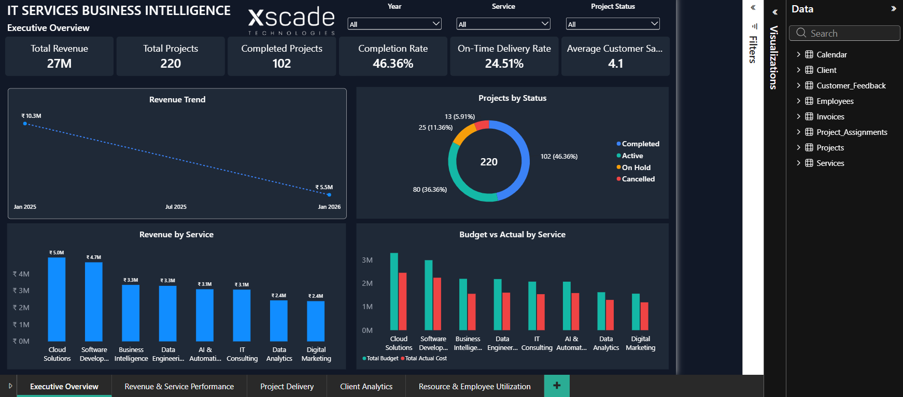
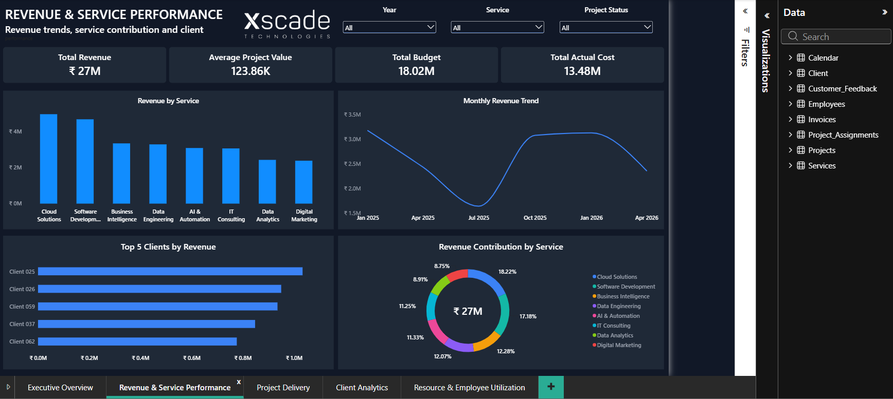
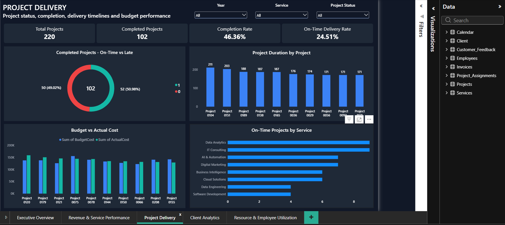
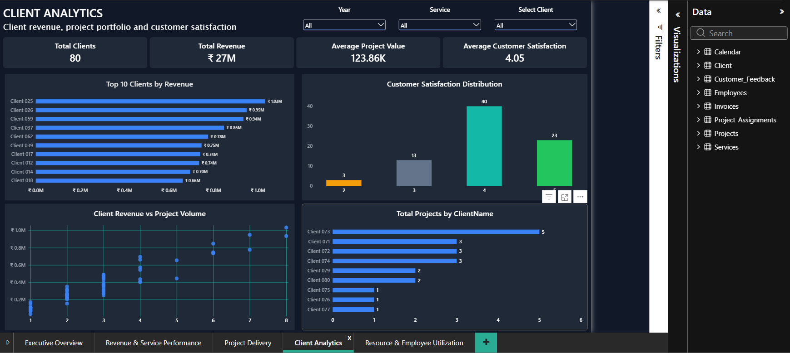
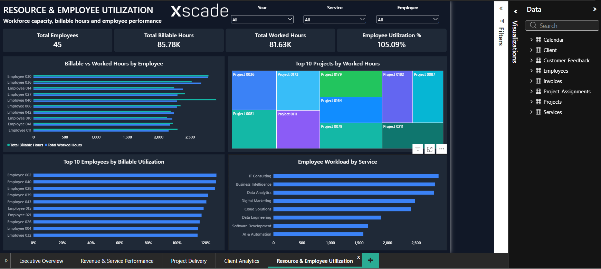

# IT Services Business Intelligence & AI-Assisted Analytics Dashboard

An end-to-end Power BI portfolio project for exploring the operational and financial performance of a fictional IT services business. It combines a SQL Server data source, Power Query preparation, a Power BI data model, DAX measures, and a five-page interactive report.

## Project overview

The dashboard brings together client, service, project, staffing, invoice, feedback, and calendar data. It is designed to help users review revenue and service performance, project delivery, client patterns, and resource utilization.

### Business objectives

- Monitor invoice revenue and service performance over time.
- Review project delivery status, timelines, and workload.
- Understand client mix and engagement patterns.
- Explore employee assignments and resource utilization.
- Bring operational and financial views together to support analysis.

These are intended uses of the dashboard. Confirm the exact definitions and visuals in the PBIX before treating a metric as a formal business KPI.

## Dashboard screenshots

The images below should be stored in `docs/screenshots/` in this repository. The links are relative to the repository so they continue to work after you upload the project to GitHub.

### 1. Executive Overview



### 2. Revenue & Service Performance



### 3. Project Delivery



### 4. Client Analytics



### 5. Resource & Employee Utilization



## Tools and technologies

- Microsoft SQL Server — database and source tables
- Power Query — data import, cleanup, and transformation
- Microsoft Power BI Desktop — data modeling and report visuals
- DAX — measures and calculated logic

## Dataset at a glance

The database is named `ITServicesBI` and contains eight tables. The row counts below are the supplied project counts; they may differ if the local database has changed.

| Table | Rows / coverage | Purpose |
|---|---:|---|
| `Client` | 80 | Client entities and attributes |
| `Services` | 8 | Service categories or offerings |
| `Projects` | 220 | Project records and delivery attributes |
| `Employees` | 45 | Employee or resource records |
| `Project_Assignments` | 709 | Employee-to-project assignment records |
| `Invoices` | 446 | Invoice or billing records |
| `Customer_Feedback` | 79 | Customer feedback records |
| `Calendar` | 2025–2026 | Date dimension; row count not supplied |

The supplied model screenshot shows the table name `Client` (singular); earlier project notes used `Clients`. Confirm the source and model name before changing it. Verify all column names, keys, date coverage, and row counts against the database.

## Data preparation and modeling

The reported workflow is:

**SQL Server → Power Query → Power BI model → DAX measures → report pages**

Typical preparation tasks include checking data types, reviewing nulls and duplicates, and confirming key relationships. Document only the transformations that are actually present in Power Query.

The model screenshot shows relationships connecting clients, services, calendar dates, projects, project assignments, employees, invoices, and customer feedback. Check relationship properties in Power BI to confirm the exact join columns, cardinality, filter direction, and date relationships.

## Dashboard pages

1. **Executive Overview** — high-level summary of business performance.
2. **Revenue & Service Performance** — revenue and service-level patterns.
3. **Project Delivery** — project workload and delivery status.
4. **Client Analytics** — client distribution and engagement patterns.
5. **Resource & Employee Utilization** — employee and assignment patterns.

Confirm the displayed visuals, slicers, and metric definitions in the PBIX before describing specific findings.

## KPI and DAX examples

The formulas below are illustrative patterns only. They do not confirm that measures with these names or definitions exist in the project. Adjust table names, column names, and business rules to match the actual model.

```DAX
Total Revenue =
SUM ( Invoices[InvoiceAmount] )

Invoice Count =
DISTINCTCOUNT ( Invoices[InvoiceID] )

Average Invoice Value =
DIVIDE ( [Total Revenue], [Invoice Count] )

Project Count =
DISTINCTCOUNT ( Projects[ProjectID] )

Completed Projects =
CALCULATE (
    [Project Count],
    Projects[Status] = "Completed"
)

Project Completion Rate =
DIVIDE ( [Completed Projects], [Project Count] )
```

Confirm what “revenue” means in the report and whether the project status field and values match these examples. A sum of invoices is not automatically equivalent to cash collected, profit, or recognized revenue.

## Key insights

**Complete this section only after checking actual report values.** No numeric findings are asserted here. For each finding, record the value, reporting period, relevant filters, and how you validated it.

- Which service contributes the largest share of the selected revenue measure?
- How many projects fall into each status shown in the report?
- Which clients have the greatest activity in the selected period?
- How are assignments distributed across employees?
- What feedback patterns appear, and how many feedback records support them?

## Setup and use

1. Install or open a compatible version of Power BI Desktop and SQL Server (or SQL Server Express).
2. Create or restore the `ITServicesBI` database using the project’s SQL scripts or supplied database backup.
3. Open the project `.pbix` file from: **`[LOCAL PATH TO PBIX]`**.
4. If prompted, configure the SQL Server connection:
   - Server: **`[LOCAL SERVER OR INSTANCE]`**
   - Database: **`ITServicesBI`**
   - Authentication: **`[SELECT YOUR CONFIGURED AUTHENTICATION METHOD]`**
5. Apply changes and refresh the report. Resolve any source or permission errors against your local database.
6. Check slicers, page filters, date range, and sample totals against SQL before interpreting report findings.

No server name, file path, username, or password is assumed here. Do not put passwords, tokens, or other credentials in this README or source control. Use your local authentication settings.

## Limitations

- The synthetic dataset may not reflect real-world distributions, seasonality, costs, service demand, staffing capacity, or customer behavior.
- Dashboard results depend on the chosen definitions, relationships, filters, and refresh state.
- Revenue should not be interpreted as profit, cash collected, or recognized revenue unless the source fields and business rules support that interpretation.
- Employee utilization requires a defined capacity denominator and treatment of leave, part-time schedules, and overlapping assignments. Assignment counts alone do not establish utilization.
- This is an analytical portfolio/demo project, not a production operational system or a source of real company records.

## Suggested repository structure

```text
IT-Services-BI-Dashboard/
├── README.md
├── docs/
│   ├── PROJECT_DOCUMENTATION.md
│   └── screenshots/
│       ├── 01-executive-overview.png
│       ├── 02-revenue-service-performance.png
│       ├── 03-project-delivery.png
│       ├── 04-client-analytics.png
│       └── 05-resource-employee-utilization.png
├── powerbi/
│   └── ITServicesBI_Dashboard.pbix
├── sql/
│   ├── schema/
│   ├── data_or_seed_scripts/
│   └── validation_queries/
└── data/
    └── [synthetic dataset file, if you intend to share it]
```
